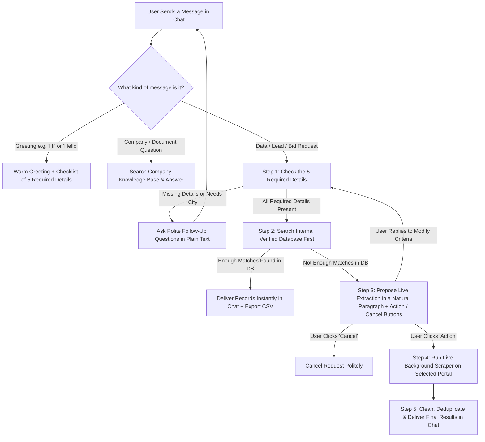

# DataOps Intelligence Platform — Complete Functional & Operational Guide

Welcome to the comprehensive operational guide for the **DataOps Intelligence Platform** (also referred to as the **AI-Powered Scraper & Lead Intelligence Platform**).

This document explains **what the platform does**, **why it exists**, **how every screen and feature works**, **how the AI assistant thinks and interacts with you**, **what data sources are connected**, and **how your team can use the system day-to-day** to discover, collect, verify, and manage construction and procurement opportunities.

This guide is written entirely from a **functional and operational perspective**—no technical background is required.

---

## Table of Contents

1. [Executive Overview: What Is This Platform?](#1-executive-overview-what-is-this-platform)
2. [Core Philosophy: How the Platform Works Behind the Scenes](#2-core-philosophy-how-the-platform-works-behind-the-scenes)
3. [User Roles & Workspace Access](#3-user-roles--workspace-access)
4. [Complete Tour of Every Screen & Workspace](#4-complete-tour-of-every-screen--workspace)
   - [4.1 Sign-In & Role Selection](#41-sign-in--role-selection)
   - [4.2 Top Navigation Bar & Global Controls](#42-top-navigation-bar--global-controls)
   - [4.3 AI Agent & Data Extraction Workspace](#43-ai-agent--data-extraction-workspace)
   - [4.4 Leads Workspace (CRM & Contact Management)](#44-leads-workspace-crm--contact-management)
   - [4.5 Datasets Registry & Dataset Inspector](#45-datasets-registry--dataset-inspector)
   - [4.6 Jobs & Extraction Telemetry Monitor](#46-jobs--extraction-telemetry-monitor)
   - [4.7 Platform Settings & Preferences](#47-platform-settings--preferences)
   - [4.8 Administrator Control Center](#48-administrator-control-center)
5. [The Conversational AI Assistant: Step-by-Step Journey](#5-the-conversational-ai-assistant-step-by-step-journey)
   - [Step 1: Understanding Your Request & Gathering Requirements](#step-1-understanding-your-request--gathering-requirements)
   - [Step 2: Instant Search in Existing Verified Records (Database-First)](#step-2-instant-search-in-existing-verified-records-database-first)
   - [Step 3: Proposing a Live Extraction (Human-in-the-Loop Confirmation)](#step-3-proposing-a-live-extraction-human-in-the-loop-confirmation)
   - [Step 4: Running the Live Extraction & Real-Time Progress](#step-4-running-the-live-extraction--real-time-progress)
   - [Step 5: Final Delivery, Partial Fulfillments & No-Match Reporting](#step-5-final-delivery-partial-fulfillments--no-match-reporting)
6. [Integrated External Data Portals (Where the Data Comes From)](#6-integrated-external-data-portals-where-the-data-comes-from)
   - [6.1 JWiz — Construction Bids & Contractor Directory](#61-jwiz--construction-bids--contractor-directory)
   - [6.2 Google Maps — Commercial Construction & Engineering Business Scraper](#62-google-maps--commercial-construction--engineering-business-scraper)
   - [6.3 Dallas Bonfire Hub — Municipal Procurement Opportunities](#63-dallas-bonfire-hub--municipal-procurement-opportunities)
   - [6.4 DASNY — Dormitory Authority of the State of New York](#64-dasny--dormitory-authority-of-the-state-of-new-york)
   - [6.5 NYSCR — New York State Contract Reporter](#65-nyscr--new-york-state-contract-reporter)
   - [6.6 Summary Comparison of All 5 Integrated Data Sources](#66-summary-comparison-of-all-5-integrated-data-sources)
7. [Data Quality, Standardization & Deduplication](#7-data-quality-standardization--deduplication)
8. [The Company Knowledge Base (Document Question-Answering)](#8-the-company-knowledge-base-document-question-answering)
9. [Practical End-to-End Scenarios (How a User Experiences the System)](#9-practical-end-to-end-scenarios-how-a-user-experiences-the-system)
10. [Tips & Best Practices for Getting the Best Results](#10-tips--best-practices-for-getting-the-best-results)

---

## 1. Executive Overview: What Is This Platform?

In the construction, contracting, and public procurement industries, finding new business opportunities and verified contractor contacts is traditionally slow, repetitive, and fragmented. Sales teams, estimators, and business development representatives often spend hours every day visiting dozens of government procurement portals, regional bid boards, and business directories—manually searching for trades, copying contact details into spreadsheets, and checking whether a company is already in their records.

The **DataOps Intelligence Platform** replaces that manual effort with an **autonomous, conversational workspace**.

Instead of clicking through external websites, you simply talk to the platform's built-in **AI Assistant** in plain everyday language—for example:
> *"Find me 20 roofing contractors in Texas with both email and phone numbers"*
>
> or
>
> *"Get me 15 general contractors in Houston, Texas from Google Maps with email addresses."*

From that single sentence, the platform:
1. **Understands your exact business criteria** (record type, trade, state/city location, quantity, required contact methods, data freshness, and preferred portal).
2. **Checks your existing internal database first** so you get instant results without waiting if matching records have already been collected.
3. **Asks for your permission before launching a live web extraction** if your internal database does not have enough matching records.
4. **Dispatches automated digital collectors ("scrapers")** to gather live bid notices, contractor profiles, and business contact details from 5 integrated procurement and commercial business portals.
5. **Cleans, verifies, and deduplicates every record** so your lists remain organized and free of duplicate entries.
6. **Delivers the verified records directly into your chat and into your workspace tables**, ready to inspect or export as a spreadsheet (CSV).

---

## 2. Core Philosophy: How the Platform Works Behind the Scenes

The platform is built around five guiding operational principles:

### 1. Conversation Over Complex Forms
You never have to configure complicated search filters or learn how different government portals or business directories organize their menus. You state what you need in a chat window. If your request is missing an important piece of information (such as which state or city you are targeting, or how many leads you need), the AI Assistant politely asks follow-up questions in plain text until your request is crystal clear.

### 2. Database-First Efficiency (Instant Answers Whenever Possible)
Collecting live data from external websites takes time. Before the platform ever goes out to an external portal, it automatically searches its own internal library of previously collected and verified records.
- **If enough matching records already exist in the system**, the assistant delivers them to you **instantly** in the chat—no waiting required.
- **If the system has zero matches, or fewer matches than you asked for**, it tells you how many it found internally and offers to go collect the rest from the live portals.

### 3. Human-in-the-Loop Control (No Surprise Extractions)
The AI Assistant will **never** start a time-consuming live web extraction without your explicit approval. Whenever a live run is needed, the assistant writes a clear, natural summary paragraph explaining what it plans to collect and from which portal, and presents two clear buttons: **Action** (to approve and start) and **Cancel** (to stop). You can also simply type a reply in the chat to adjust your criteria (for example, changing the quantity or city) before approving.

### 4. Multi-Source & Multi-Type Intelligence
The platform understands the difference between two primary types of industry records:
- **Leads (Contractors / Vendors / Subcontractors / Commercial Businesses)**: Companies and contact people you want to reach out to, partner with, or sell to—complete with company names, trades, phone numbers, email addresses, websites, ratings, and social media links.
- **Opportunities (RFPs / Solicitations / Bids)**: Active construction projects, municipal tenders, and government procurement notices that are open for bidding, complete with issuing agencies, submission deadlines, and bid links.

### 5. Complete Transparency & Auditability
Every extraction job, every dataset created, every record delivered to a user, and every user action is logged. Team members can monitor live progress bars while extractions run, and administrators can review a complete history of all user activity and delivered datasets across the organization.

---

## 3. User Roles & Workspace Access

When signing into the platform, users operate under one of two access levels:

### Standard User (`User`)
Designed for sales representatives, estimators, researchers, and marketing team members. Standard users have full access to all day-to-day operational workspaces:
- **AI Agent & Scraper**: Chat with the assistant, search existing records, launch approved live extractions, and download delivered results.
- **Leads Workspace**: Browse, search, filter, inspect, and export all verified leads in the platform.
- **Datasets**: View all compiled datasets, inspect the rows inside each dataset, and download datasets as CSV spreadsheets.
- **Jobs Monitor**: Track active, queued, completed, or failed extraction jobs and inspect their step-by-step execution logs.
- **Settings**: View and update personal profile details and notification preferences.

### Administrator (`Admin`)
Designed for platform owners, operations managers, and team leads. The platform enforces a **single, protected Administrator account** that cannot be disabled or downgraded. In addition to every workspace available to Standard Users, the Administrator has exclusive access to the **Admin Control Center** at the bottom of the navigation sidebar:
- **Activity Logs & Delivered Data**: Monitor every user's login, registration, extraction jobs, and exact data deliveries (grouped by user email address), with full CSV export capabilities and fulfillment status tracking.
- **User Management**: Create new standard user accounts (requiring a username, password, and valid email address), enable or disable existing user accounts, and view account creation dates.
- **Knowledge Base**: Upload company documents (PDFs, Word documents, Markdown, or text files) so the AI Assistant can answer questions about internal company policies, playbooks, and reference materials.
- **Enterprise Settings Tabs**: View department quota allocations, role permission rules, and active AI reasoning configurations.

---

## 4. Complete Tour of Every Screen & Workspace

### 4.1 Sign-In & Role Selection
When you open the platform, you are greeted by the **DataOps Intelligence Portal** sign-in screen:
- **Role Selector Toggle**: At the top of the sign-in card, you can toggle between **User** and **Admin** login modes.
- **Credentials**: Enter your assigned **Username** and **Password** and click **Sign In**.
- **Account Status Protection**: If an administrator has disabled a user's account, the system prevents sign-in and displays a clear message explaining that the account is inactive.

---

### 4.2 Top Navigation Bar & Global Controls
Once signed in, the top header remains visible across every screen and provides quick situational awareness:
- **Page Title & Personalized Greeting**: Displays the name of the current workspace alongside a time-of-day greeting (*"Good morning"*, *"Good afternoon"*, or *"Good evening"*) and your department name.
- **Global Search Bar**: Located in the center of the header, allowing you to quickly filter records across workspaces.
- **System Health Badge**: Shows at a glance whether the platform's background services are online and healthy.
- **Notifications Dropdown**: Displays recent system alerts, dataset completions, and operational updates.
- **Dark Mode / Light Mode Toggle**: Switch between a crisp light interface and a high-contrast dark theme at any time.
- **Role Badge & Sign Out**: Shows your display name and role badge (`USER` or `ADMIN`), next to a one-click **Sign Out** button.

---

### 4.3 AI Agent & Data Extraction Workspace
This is the primary command center of the platform. It is divided into two main areas (with a collapsible right-hand summary panel):

#### Left & Center Area: The Conversational Chat Interface
- **Conversation Threads Toolbar**: At the top of the chat window, a dropdown menu lets you switch between your past conversation threads, see how many messages are in each thread, **create a new conversation** (`+` button), or **delete an old conversation** (trash icon). Each user's conversations are completely private to their account.
- **Chat Message Stream**: Shows the full back-and-forth dialogue between you and the AI Assistant.
  - When the assistant is working, a live indicator (*"AI Agent is processing request..."*) appears.
  - When a background extraction is actively running on external websites, an animated banner (*"Scraping in progress — fetching your requested records. Results will appear here automatically when ready."*) keeps you informed, and the chat automatically polls and updates the moment the extraction finishes.
- **Interactive Confirmation Buttons (`Action` / `Cancel`)**: Whenever the assistant proposes a live extraction, interactive **Action** and **Cancel** buttons appear directly beneath the assistant's message so you can approve or decline with a single click.
- **Delivered Leads Table (Inline in Chat)**: Whenever the assistant delivers records (either instantly from the database or after a live extraction finishes), an interactive **Delivered Leads** card appears right inside the chat message:
  - Displays a summary header showing the total number of delivered leads.
  - **Export CSV Button**: Lets you immediately download those exact delivered records as a clean CSV spreadsheet file.
  - **Expandable Preview Table**: Shows the first 5 records right away (Name, Company, Email, Phone, Location, and Source) with a **Show All / Show Less** button to expand the entire list inside the chat.
- **Message Input Box**: At the bottom, type any request or question and press `Enter` (or click the Send button). While a live extraction is running in that conversation, the input box temporarily locks to prevent overlapping jobs in the same thread (though you can open a new thread at any time).

#### Right-Hand Panel: Live Requirement Summary Panel
As you talk to the assistant, the collapsible **Requirement Summary Panel** on the right side of the screen updates in real time so you can see exactly how the AI has interpreted your request:
1. **Extracted Intent & Criteria**:
   - **Target Vertical / Trade**: The construction trade, category, or industry being targeted.
   - **Geography**: The target US State and/or City.
   - **Company Size**: Target organization scale.
   - **Target Roles**: Decision-maker titles (such as Estimator, Purchasing Manager, VP Construction, or General Contractor).
2. **Required Data Fields**: Checkmarks indicating which fields are being enforced (Verified Email, Direct Phone, Company Domain, Decision Maker Title, and Dedup Check).
3. **Data Source Strategy**: Shows whether the system is currently checking the **Internal Database First** or targeting an **External Portal**.
4. **Department Assignment**: Displays the operational department context.
5. **Estimated Output**: Shows the expected yield and verification target before execution begins.

---

### 4.4 Leads Workspace (CRM & Contact Management)
Accessible from **Leads Workspace** in the left sidebar, this screen serves as your central directory for all collected and verified leads across the platform.

- **Top Action Bar**:
  - Displays the total count of verified leads and how many have phone numbers ready for outreach.
  - **Refresh Button**: Pulls the latest records from the database.
  - **Export CSV Button**: Exports all currently visible leads into a spreadsheet containing Name, Company, Title, Email, Phone, Location, Status, Source, and Created Date.
- **Search & Filter Controls**:
  - **Instant Search Box**: Type any person's name, company name, job title, email address, or city/state to filter the table immediately.
  - **Department Filter**: Filter leads by department (*All Departments, Sales 1, Sales 2, Email Marketing, Business Development, Research*).
  - **Status Filter**: Filter leads by their outreach stage (*All Statuses, New, Called, Emailed, Interested, Follow Up, Qualified*).
- **High-Density Leads Table**:
  - Displays columns for **Contact Name, Company, Title, Email, Phone, Location, Status Badge, Assigned Rep, Last Activity, and Actions**.
  - Supports multi-row checkboxes and pagination (10 leads per page) for easy browsing.
- **Slide-Over Lead Detail Drawer**:
  - Clicking any row in the table opens a detailed slide-over panel on the right side of the screen.
  - Shows complete **Contact Information** (clickable email link, phone number, location, LinkedIn profile), **Company Information** (company name, industry, company size, clickable website link), **Assignment & Operational Context** (assigned rep, department, source dataset, and rep notes), and a chronological **Activity Timeline** showing when the lead was ingested and last contacted.

---

### 4.5 Datasets Registry & Dataset Inspector
Accessible from **Datasets** in the left sidebar, this workspace organizes your extracted records into structured, named collections. Whenever a scraping job completes and saves records, a dataset is automatically created or updated.

#### Main Datasets Overview Screen
- **Summary KPI Cards**: Three top-level metric cards show:
  1. **Total Datasets**: Number of distinct datasets in the system.
  2. **Total Enriched Leads**: Combined number of records stored across all datasets.
  3. **Avg. Email Coverage**: The average percentage of records that include a verified email address.
- **Search & Department Filter**: Search datasets by name, trade, or location, or filter by assigned department.
- **Datasets Table**: Lists every dataset with its **Dataset Name & ID, Industry / Trade, Location Scope, Total Rows, Email Coverage % (with visual progress bar), Phone Coverage % (with visual progress bar), Source Type badge, Assigned Department, Created Date**, and quick action buttons to **Inspect** or **Download CSV**.

#### Dataset Detail Inspector (Clicking into a Dataset)
When you click on any dataset row (or click its **Inspect** button), you open the dedicated **Dataset Detail** view:
- **Dataset Header & Export**: Shows the dataset title, status badge, creation metadata, and an **Export Dataset CSV** button.
- **4 Data Quality Metric Cards**:
  1. **Total Leads** (and count of duplicate records removed).
  2. **Verified Emails** (percentage of records with valid emails).
  3. **Verified Phones** (percentage of records with direct phone numbers).
  4. **Deduplication Rate** (confirming 100% clean, unique records).
- **Extraction Parameters Summary**: Shows the exact Target Roles, Company Size, Source Portals, and Assigned Department used to build the dataset.
- **Embedded Leads Table & Drawer**: Lets you search, filter, and click into every individual lead belonging to that specific dataset.

---

### 4.6 Jobs & Extraction Telemetry Monitor
Accessible from **Jobs** in the left sidebar, this screen gives you real-time visibility into every background data extraction job that has been queued, is currently running, or has finished.

#### Main Jobs Queue Screen
- **4 Live Pipeline Status Cards**:
  1. **Active Jobs**: Number of scrapers currently running or validating data.
  2. **Queued**: Jobs waiting in line for an available worker.
  3. **Completed**: Successfully finished extraction runs.
  4. **Failed / Throttled**: Jobs that encountered a portal timeout or connection issue.
- **Jobs Telemetry Table**:
  - Lists every job with its **Job ID & Target Summary, Status Badge** (*Queued, Scraping, Validating, Deduplicating, Completed, or Failed*), **Source Portal Badge**, **Live Progress Bar (0% to 100%)**, **Found vs. Verified Record Counts**, **Duplicates Removed Count**, **Duration**, and **Started Time**.
  - While any job is active, the screen automatically refreshes every few seconds so you can watch the progress bar advance live.

#### Job Detail Telemetry View (Clicking into a Job)
Clicking any job row opens its deep-dive **Job Execution Telemetry** page:
- **5 Execution Metric Cards**:
  1. **Overall Progress %** (with visual bar).
  2. **Records Found** (total raw records discovered on the portal).
  3. **Verified Leads** (records that passed quality and filter checks).
  4. **Duplicates Removed** (records already existing in the database that were merged/skipped).
  5. **Errors / Retries** (any network retries handled during the run).
- **Pipeline Stage Breakdown**: Shows the target trade, target geography, source strategy, and current execution stage.
- **Live Terminal Execution Logs**: A dark terminal-style window displaying timestamped, step-by-step operational messages from the scraper (for example, initializing the browser, navigating to the portal, extracting rows, verifying contacts, and saving to the database).
- **View Generated Dataset Button**: Once a job finishes, a button appears allowing you to jump straight to the resulting dataset.

---

### 4.7 Platform Settings & Preferences
Accessible from **Settings** in the left sidebar, this page allows users and administrators to review and configure workspace preferences:
- **Profile & Security Tab**: View your user avatar, role title, department, full name, and corporate email address.
- **Notifications Tab**: Toggle alert rules for *Dataset Completion Alerts*, *High Intent Lead Replies*, *Task & Follow-up Reminders*, and *Cluster Job Error Telemetry*.
- **Administrator-Only Configuration Tabs** (visible only when signed in as `Admin`):
  - **Departments Tab**: Displays monthly verified lead budget allocations across enterprise departments (*Sales 1, Sales 2, Email Marketing, Business Development, Research*).
  - **Roles & Permissions Tab**: Summarizes global admin vs. scoped user workspace permissions.
  - **AI Agents & Models Tab**: Displays the active status of the platform's reasoning and deduplication engines.

---

### 4.8 Administrator Control Center
Visible only to the **Administrator** at the bottom of the left sidebar, the Admin Control Center provides three governance workspaces:

#### 1. Activity Logs (`Admin -> Activity Logs`)
This screen has two sub-tabs at the top:
- **Delivered Data Tab (Default)**:
  - Provides a complete audit trail of every dataset delivered to every user via the AI Assistant, **grouped by each user's email address** (with the administrator's own runs grouped under `admin`).
  - Clicking a user's folder expands their list of deliveries. Each delivery shows:
    - The user's original **Query** and timestamp.
    - A clear **Fulfillment Badge**: Green (`Request fulfilled — X records delivered`) when the user's exact target count was met, or Amber (`Request not fulfilled — X of Y required matches found`) when the portal had fewer matching records than requested.
    - **What the Model Understood**: Displays the structured criteria the AI extracted from the conversation (Record Type, Trade, Location, Count, Contact Type, Source, Freshness).
    - **Full Delivered Records Table & Export CSV**: Administrators can inspect every single row delivered to that user (including Company, Contact, Email, Phone, City, State, Source, Trade, Opportunity Title, and Closing Date) and download the exact delivery as a CSV spreadsheet.
- **Activity Logs Tab**:
  - Displays platform-wide usage statistics (**Total Users, Active Users, Total Jobs Run, and Total Chat Sessions**) alongside a chronological **Recent Activity Feed** showing every user login, user registration, and scrape job event across the system.

#### 2. User Management (`Admin -> User Management`)
- **Create User Form**: Allows the administrator to create new team accounts by entering a **Username**, **Password**, and **Email Address**. All created accounts are assigned the standard `User` role (the platform enforces a single, protected `Admin` account).
- **All Users Directory**: Lists every account in the system with its Username, Email, Role badge, Status badge (`Active` or `Disabled`), and Created Date.
- **Instant Account Enable / Disable**: With a single click on **Disable** or **Enable**, the administrator can revoke or restore a user's ability to sign into the platform (the primary `Admin` account is marked `Protected` and cannot be disabled).

#### 3. Knowledge Base (`Admin -> Knowledge Base`)
- Allows the administrator to upload and manage reference documents (**PDF, DOCX, TXT, and MD** files up to 20 MB each) that teach the AI Assistant about internal company information.
- **Upload Document Card**: Select a file from your computer and click **Upload & Ingest**. The platform reads the document, breaks it into searchable sections, and indexes it immediately.
- **Ingested Documents Table**: Lists every uploaded document with its filename, file type badge, number of indexed text sections ("chunks"), upload timestamp, and a **Delete** button (with confirmation) to remove outdated documents.

---

## 5. The Conversational AI Assistant: Step-by-Step Journey

The heart of the platform is the **AI Assistant** in the **AI Agent & Scraper** workspace. Rather than acting like a basic chatbot that only gives generic text replies, the assistant follows a structured, five-step operational workflow on every request.

### Greeting & General Questions Behavior
- **When you say "Hi" or "Hello"**: The assistant responds warmly in your language and immediately gives you a helpful checklist of the **5 required details** needed to start a data request (noting that data source and freshness are optional), without running any unnecessary database searches.
- **Clean Plain-Text Responses**: The assistant always writes in clean, natural, easy-to-read plain text without cluttered formatting symbols.

---

### Step 1: Understanding Your Request & Gathering Requirements
When you ask for leads, contractors, or bid opportunities, the assistant checks your conversation history to extract **5 Required Details** and **2 Optional Details**:

#### The 5 Required Details
1. **Record Type**: Are you looking for **Leads** (contractors, vendors, subcontractors, commercial businesses) or **Opportunities** (RFPs, bids, solicitations, procurement tenders)?
2. **Trade / Category**: What industry specialty or construction trade do you need? (e.g., *Roofing, Plumbing, HVAC, Electrical, Concrete, General Contracting, Civil Engineering, Janitorial*, etc.)
3. **Location (State vs. City Rules)**:
   - **Standard State-Level Portals (`JWiz`, `Dallas Bonfire`, `DASNY`, `NYSCR`)**: Only a **US State** is required (for example, *New York*, *Texas*, *Florida*, or *California*). You can also explicitly say *"any location"* if you want to search across all states in the internal database. Note that **JWiz only requires a US State** to run a live scrape and does not require a city.
   - **City-Required Portal (`Google Maps`)**: Because Google Maps searches commercial businesses city-by-city, **Google Maps requires a specific US City in addition to the State** (for example, *Houston, Texas* or *Miami, Florida*). If you choose Google Maps (or if Google Maps is the best match for your request) and you only mention a state like *"Texas"*, the assistant will automatically ask: *"Which city in Texas would you like me to search?"*
   - **327 Supported US Cities Validation**: Google Maps supports **327 major US cities**. If you request a city that is not among the 327 supported cities, the assistant will immediately let you know (`Requested City Data Not Avaliable`) and provide the list of supported cities you can choose from.
4. **Quantity (Count)**: How many records do you want? (For example, *10*, *25*, or *50*).
5. **Required Contact Information**: What contact details must each record have?
   - *Email only*
   - *Phone only*
   - *Both email and phone*
   - *Any / No preference* (if you want all matching records regardless of whether an email or phone is listed).

#### The 2 Optional Details
6. **Preferred Portal / Source** *(Optional)*: You can name a specific portal (*JWiz, Google Maps, Bonfire, DASNY, or NYSCR*), or leave it blank and let the assistant automatically pick the best portal for your location and record type.
7. **Freshness / Recency** *(Optional)*: You can ask for records from the *last 24 hours*, *last 7 days*, *last 30 days*, *only still-open bids*, or *any time*.

> **How the Assistant Handles Missing Information**: If your first message only provides two or three of the required details (for example, *"I need 15 roofing contractors"*), the assistant acknowledges what you already gave it and asks only for the missing pieces (in that example, the **Location** and **Required Contact Information**).

---

### Step 2: Instant Search in Existing Verified Records (Database-First)
As soon as all required details are known, the assistant **immediately searches the platform's internal database** using your exact filters:
- **Scenario A — Full Match in Database**: Suppose you ask for *10 plumbing contractors in New York with phone numbers*, and the internal database already has 10 or more matching records. The assistant delivers all 10 records to you **immediately** in the chat table. No live web scraping is needed, and you get your spreadsheet right away.
- **Scenario B — Partial Match or Zero Match in Database**: Suppose you ask for *20 electrical contractors in Texas with emails*, and the internal database only has 4 matching records (or 0). The assistant tells you exactly how many it found in the database and proceeds to **Step 3** to offer a live extraction for the rest.

---

### Step 3: Proposing a Live Extraction (Human-in-the-Loop Confirmation)
When a live web extraction is needed, the assistant prepares a clear, human-friendly proposal:
- **Smart Portal Selection & Mismatch Warnings**:
  - If you did not specify a portal, the assistant selects the best-fitting portal automatically based on whether you need Leads or Opportunities and which state/city you targeted.
  - If you asked for a portal that does not match your geography or record type (for example, asking to scrape *Florida* records from *DASNY*, which is a New York state authority, or asking for *Texas* bids from *NYSCR*), the assistant warns you clearly about the mismatch so you don't waste time running an incompatible search.
- **Natural Paragraph Proposal**: The assistant describes the planned extraction in a smooth, natural paragraph—weaving together the **quantity**, **trade/category**, **city/state**, **target portal name**, and any **contact or freshness filters** you requested—and asks you to click **Action** to begin or **Cancel** to abort.
- **Three Ways You Can Respond**:
  1. **Click `Action` (or type "yes" / "proceed")**: Approves the proposal and launches the live scraper immediately.
  2. **Click `Cancel` (or type "no" / "cancel")**: Cancels the proposed extraction cleanly.
  3. **Type a Modification in Chat**: If you change your mind before clicking Action—for example, typing *"Actually, make it 30 records instead of 15"* or *"Switch the city to Dallas"*—the assistant updates your criteria, re-checks the internal database with the new rules, and presents an updated confirmation proposal.

---

### Step 4: Running the Live Extraction & Real-Time Progress
Once you click **Action**:
1. The assistant confirms that your extraction job has been queued and started in the background.
2. An animated progress banner appears at the bottom of your chat window, and a new entry appears in the **Jobs** workspace.
3. Behind the scenes, a dedicated background worker opens the target portal, searches your requested trade and location, visits detail pages (and company websites when using Google Maps), normalizes phone numbers and emails, and saves every valid record into the central database while filtering out duplicates.

---

### Step 5: Final Delivery, Partial Fulfillments & No-Match Reporting
As soon as the background worker finishes, your chat window updates automatically with the final outcome:

1. **Full Fulfillment**: If the scraper found and verified all the records you asked for (for example, 15 out of 15), the assistant delivers the complete list in an interactive table right inside the chat, ready for you to inspect or download via **Export CSV**.
2. **Partial Fulfillment (Honest Shortfall Reporting)**: Sometimes an external portal simply does not have as many matching records as you asked for (for example, you asked for 20 contractors in a specific trade with verified email addresses, and only 6 existed on the portal).
   - The assistant delivers the **6 matching records** that met your criteria and clearly explains the shortfall (including how many total raw records were scanned on the portal and why fewer matched your strict filters, such as missing emails or trade filters).
   - **No Noisy Data Dumps**: The assistant will **never** clutter your chat by dumping unrelated or unverified rows that failed your criteria. All valid records discovered during the run are still safely stored in the platform's database for future searches, while your chat delivery stays clean and strictly relevant.
3. **Zero Matches Found (`Requested data not found`)**: If the live scrape completes normally without errors or timeouts, but zero records on the portal match your requested criteria, the assistant replies clearly with:
   > `Requested data not found`
4. **Portal Timeout or Connection Error**: If an external government website is temporarily down or times out during the run, the assistant explains the technical interruption clearly so you know why the job stopped and can retry later.

---

## 6. Integrated External Data Portals (Where the Data Comes From)

The platform connects to **five specialized external data portals**, covering both **commercial contractor/business directories** and **public/government procurement boards**.

### 6.1 JWiz — Construction Bids & Contractor Directory
- **Internal Source Identifier**: `jwiz`
- **Primary Focus**: Nationwide US construction bids, procurement tenders, and registered contractor/vendor profiles across all 50 US states.
- **Record Types Supported**: Both **Leads** (contractors/vendors) and **Opportunities** (construction bids/solicitations).
- **Location Requirement**: **US State only** (e.g., *New York, Texas, California, Florida*). A city is **not** required for JWiz.
- **How It Works**:
  - The scraper navigates to the JWiz regional directory for your target US State and searches by your requested construction trade or category keyword.
  - It collects project and company listings, and then visits each individual detail page to extract the full **Company or Agency Name, Contact Person, Direct Phone Number, Email Address, City/State Location, Trade Category, Solicitation/Bid Title, Posted Date, Submission Closing Date, and Source Link**.

---

### 6.2 Google Maps — Commercial Construction & Engineering Business Scraper
- **Internal Source Identifier**: `googlemaps`
- **Primary Focus**: Verified local and commercial construction, contracting, and engineering companies across the United States, enriched with direct website contact discovery.
- **Record Types Supported**: **Leads** (commercial businesses, contractors, subcontractors, engineering firms).
- **Location Requirement**: **Requires both a US State AND a specific US City** (validated against **327 supported US cities** across all 50 states and DC).
- **38 Supported Construction & Engineering Categories**:
  The Google Maps collector is purpose-built for construction and engineering intelligence and maps user requests across **38 specialized categories**, including:
  - *General & Commercial*: General Contractor, Commercial General Contractor, Residential General Contractor, Design-Build Contractor, Construction Management Firm, Prefabricated / Modular Building Contractor.
  - *Engineering & Design*: Civil Engineering Firm, Structural Engineering Firm, Mechanical Engineering Firm, Electrical Engineering Firm, Geotechnical Engineering Firm, Environmental Engineering Firm, Architectural & Engineering (A&E) Firm, MEP Contractor / Engineer, BIM (Building Information Modeling) Service Provider, Land Surveying Company.
  - *Site & Heavy Civil*: Excavation & Grading Contractor, Demolition Contractor, Concrete Contractor (Flatwork, Foundations, Structural), Paving & Asphalt Contractor, Pile Driving & Foundation Contractor, Utility & Underground Infrastructure Contractor.
  - *Building Envelope & Structural Trades*: Structural Steel & Ironwork Contractor, Masonry Contractor, Roofing Contractor, Waterproofing & Building Envelope Contractor, Glazing & Curtain Wall Contractor, Framing Contractor (Wood & Metal Stud).
  - *Interior & Specialty Trades*: Electrical Contractor, Plumbing Contractor, HVAC & Mechanical Contractor, Fire Protection & Sprinkler Contractor, Drywall & Insulation Contractor, Painting & Coatings Contractor, Flooring Contractor, Millwork & Casework Contractor, Elevator & Vertical Transportation Contractor, Solar & Renewable Energy Contractor.
- **How It Works (Two-Stage Deep Enrichment)**:
  1. **Stage 1 — Google Maps Business Discovery**: Searches Google Maps for your exact trade category in your target city and state, scrolling through listings and opening each business card to capture the **Company Name, Google Maps Profile URL, Star Rating, Total Review Count, Phone Number, Official Website URL, Full Street Address (parsed into Street, City, State, and ZIP), Service Category Tags, and up to 5 Featured Customer Reviews**.
  2. **Stage 2 — Automatic Company Website Crawling for Emails & Social Media**: For every business that lists a website on Google Maps, the collector automatically visits the company's actual website (including its homepage and contact pages) to discover and extract **Email Addresses** and official **Social Media Profiles** (**Facebook, Instagram, LinkedIn, Twitter/X, Pinterest, and YouTube**).

---

### 6.3 Dallas Bonfire Hub — Municipal Procurement Opportunities
- **Internal Source Identifier**: `bonfire`
- **Primary Focus**: City of Dallas (Texas) municipal procurement solicitations, construction tenders, and city vendor contracts.
- **Record Types Supported**: **Opportunities** (open and closed municipal RFPs, RFQs, and bids) and **Issuing Buyer Contacts**.
- **Location Requirement**: **State-level (`Texas` / Dallas Municipal)**. Does not require a separate city prompt when Texas/Bonfire is selected.
- **How It Works**:
  - Connects to the Dallas Bonfire Procurement Portal and scans open opportunities matching your trade or keyword.
  - Visits each solicitation's detail page to capture the **Solicitation Reference ID, Project Title, Issuing Department, Contact Person Name, Contact Email Address, Status, Posted Date, Submission Closing Date, Full Project Description, and Direct Opportunity Portal URL**.

---

### 6.4 DASNY — Dormitory Authority of the State of New York
- **Internal Source Identifier**: `dasny`
- **Primary Focus**: Public institutional construction, healthcare, university, and infrastructure procurement contracts issued by the State of New York.
- **Record Types Supported**: **Opportunities** (construction and professional service bids/RFPs) and associated vendor/contract records.
- **Location Requirement**: **State-level (`New York`)**.
- **How It Works**:
  - Navigates the official DASNY Opportunities portal, scanning active procurement tables and filtering by your requested construction trade or service category.
  - Opens individual solicitation detail pages to extract the **Solicitation Title, Classification/Category, Opportunity Type, Posted Date, Response Deadline, Project Attachment Links, and Issuing Agency Details**.

---

### 6.5 NYSCR — New York State Contract Reporter
- **Internal Source Identifier**: `nyscr`
- **Primary Focus**: Official New York State statewide government contract advertisements, public works bids, and agency procurement notices.
- **Record Types Supported**: **Opportunities** (statewide government bids and RFPs) and **Issuing Agency / Contracting Officer Contacts**.
- **Location Requirement**: **State-level (`New York`)**.
- **How It Works**:
  - Logs into the New York State Contract Reporter portal using configured credentials and runs targeted searches for your trade or procurement category.
  - Visits each contract advertisement to extract the **Agency Name, Division, Contract Number, Notice Type, Bid Title, Issue Date, Due Date, Full Street Address, Contact Person Name, Title, Phone Number, Email Address, and Full Bid Description**.

---

### 6.6 Summary Comparison of All 5 Integrated Data Sources

| Portal Name | Source ID | Primary Record Type | Geographic Coverage | Location Granularity Required | Key Extracted Information |
| :--- | :--- | :--- | :--- | :--- | :--- |
| **JWiz Directory** | `jwiz` | Leads & Opportunities | All 50 US States | **US State Only** (No city required) | Company/Agency, Contact Name, Phone, Email, State, Trade, Bid Title, Closing Date |
| **Google Maps Business Scraper** | `googlemaps` | Leads (Commercial Businesses & Contractors) | 327 Supported US Cities across all 50 States | **US State + Specific City Required** | Company Name, Phone, Website-Crawled Emails, Address, Rating, Reviews, 38 Trade Categories, Social Media Links |
| **Dallas Bonfire Hub** | `bonfire` | Opportunities & Municipal Buyer Contacts | Dallas / Texas | **US State Only** (`Texas`) | Solicitation ID, Bid Title, Buyer Contact Name & Email, Closing Date, Project Scope |
| **DASNY Portal** | `dasny` | Opportunities & Public Construction Bids | New York State | **US State Only** (`New York`) | Solicitation Title, Trade Classification, Posted Date, Due Date, Bid Attachments |
| **NYSCR Reporter** | `nyscr` | Opportunities & State Agency Contacts | New York State | **US State Only** (`New York`) | State Agency, Contract Number, Bid Title, Due Date, Contracting Officer Name, Phone, Email |

---

## 7. Data Quality, Standardization & Deduplication

Because different websites format their information in completely different ways, the platform automatically runs every extracted record through a **Data Standardization and Deduplication Pipeline** before saving it or showing it to you:

1. **Unified Record Format**: Whether a record comes from JWiz, Google Maps, Dallas Bonfire, DASNY, or NYSCR, the platform maps its fields into a single, consistent structure (Company Name, Contact Name, Email, Phone, Website, Street, City, State, Trade, Record Type, Solicitation Title, Posted Date, Closing Date, and Source Link).
2. **Contact Cleaning & Validation**:
   - Phone numbers are stripped of messy formatting and checked to ensure they are real, dialable numbers.
   - Email addresses are validated for proper structure, and junk links (such as image filenames or placeholder text found on websites) are automatically filtered out.
3. **Strict Deduplication (Zero Duplicate Clutter)**:
   - Every time a scraper collects a record, the platform generates a unique fingerprint based on its core identity (such as its source portal, company name, solicitation title, and contact information).
   - If that exact record already exists in the central database, the platform updates or skips the duplicate rather than creating a second copy. This guarantees that your **Leads Workspace** and **Datasets** remain clean even when multiple team members run overlapping searches.
4. **Post-Scrape Requirement Verification**:
   - After a scraper finishes collecting records from a portal, the platform double-checks every newly collected record against the exact requirements you gave the AI Assistant (for example, verifying that every delivered lead actually has an email address if you asked for *"email required"*). Only records that pass your criteria are counted toward your delivery fulfillment.

---

## 8. The Company Knowledge Base (Document Question-Answering)

In addition to finding external leads and procurement bids, the AI Assistant also serves as an **internal company knowledge assistant**.

- **How Administrators Feed Knowledge**: In the **Admin -> Knowledge Base** screen, the administrator can upload internal documents such as sales playbooks, standard operating procedures, bidding guidelines, company capability statements, or onboarding manuals (in PDF, Word, Markdown, or text format).
- **How Users Ask Questions**: In the **AI Agent & Scraper** chat, any user can ask natural questions about those uploaded documents (for example, *"What is our standard qualification process for commercial roofing bids?"* or *"Summarize our company's safety compliance requirements"*).
- **Grounded Answers with Source Citations**: When your message is a knowledge question rather than a lead-generation request, the assistant automatically searches the uploaded Knowledge Base documents and writes a clear answer based strictly on your company's files, citing which document the information came from.

---

## 9. Practical End-to-End Scenarios (How a User Experiences the System)

### Scenario 1: City-Specific Contractor Search via Google Maps
1. **User types**: *"I need 15 HVAC contractors in Texas with email addresses from Google Maps."*
2. **Assistant checks requirements**: It sees Record Type (*Leads / Contractors*), Trade (*HVAC*), State (*Texas*), Quantity (*15*), Contact (*Email required*), and Source (*Google Maps*). Because Google Maps requires a specific city, the assistant asks:
   > *"Which city in Texas would you like me to search on Google Maps?"*
3. **User replies**: *"Austin"*
4. **Database-First Check**: The assistant validates that *Austin* is one of the 327 supported US cities and checks the internal database first. Suppose only 2 matching Austin HVAC contractors with emails exist internally.
5. **Proposal**: The assistant writes a natural confirmation paragraph explaining that it found 2 matches in the database and is ready to launch a live Google Maps extraction for 15 HVAC contractors in Austin, Texas with verified email addresses, and displays the **Action** and **Cancel** buttons.
6. **Execution & Enrichment**: The user clicks **Action**. The Google Maps scraper searches HVAC contractors in Austin, collects their business profiles, ratings, and phone numbers, and then visits each contractor's website to find their email addresses and social media pages.
7. **Delivery**: Once finished, the verified Austin HVAC contractors appear right inside the chat window with a one-click **Export CSV** button, and are permanently added to the **Leads Workspace** and **Datasets** registry.

---

### Scenario 2: Statewide Construction Bid Search via JWiz (No City Needed)
1. **User types**: *"Find me 10 plumbing leads in New York with phone numbers from JWiz."*
2. **Assistant checks requirements**: All 5 required details are present (*Leads, Plumbing, New York, 10 records, Phone required*), and JWiz only requires a US State (no city needed).
3. **Database-First Check**: The assistant checks the internal database.
   - If 10 matching New York plumbing records with phone numbers are already in the database, they are displayed in the chat **instantly**.
   - If fewer than 10 exist, the assistant presents a natural confirmation paragraph with **Action** and **Cancel** buttons to scrape JWiz for New York plumbing leads.

---

### Scenario 3: Modifying a Proposal Before Clicking Action
1. **Assistant proposes**: *"I can run a live extraction on the Dallas Bonfire portal to collect 10 roofing procurement opportunities in Texas with buyer email addresses. Click Action below to start the extraction, or Cancel to stop."*
2. **User types in chat instead of clicking**: *"Change it to 25 opportunities instead."*
3. **Assistant adapts**: The assistant updates the target count to 25, re-checks the internal database for 25 matches, and presents an updated confirmation paragraph for 25 opportunities with fresh **Action** and **Cancel** buttons.

---

### Scenario 4: When a Portal Has Zero Matching Records
1. A user approves a live extraction for a very narrow niche (for example, a specialized trade in a small market with strict contact requirements).
2. The scraper runs to completion without any errors, checks all listings on the portal, and finds 0 records that match the user's criteria.
3. Instead of showing unrelated records, the assistant responds clearly with:
   > `Requested data not found`
4. Meanwhile, the administrator can view the attempt under **Admin -> Activity Logs -> Delivered Data**, which clearly logs `Request not fulfilled — 0 of X required matches found` alongside the exact criteria the model understood.

---

## 10. Tips & Best Practices for Getting the Best Results

1. **Include the 5 Key Details Upfront for the Fastest Experience**:
   To skip follow-up questions and go straight to results, include all five details in your very first message:
   - **Record Type** (*contractors/leads* vs. *bids/opportunities*)
   - **Trade / Category** (e.g., *Roofing, Electrical, HVAC, Concrete, Civil Engineering*)
   - **Location** (*State* for JWiz/Bonfire/DASNY/NYSCR, or *City + State* for Google Maps)
   - **Quantity** (e.g., *10, 20, 50*)
   - **Contact Requirement** (*email*, *phone*, *both*, or *any contact info*)
   - *Example Prompt*: *"Find 20 commercial roofing contractors in Miami, Florida from Google Maps with both email and phone."*
   - *Example Prompt*: *"Get me 15 electrical opportunities in New York from NYSCR with any contact info."*

2. **Use "Any Contact Info" When Searching Public Bid Portals**:
   Government bid portals like **DASNY** often publish solicitation notices and project PDFs without listing a direct individual email or phone number on the summary row. When searching for procurement opportunities on public portals, specifying *"any contact info"* or *"no contact filter"* ensures you receive all relevant open bids.

3. **Use Google Maps When You Need Direct Company Websites, Emails & Social Links**:
   When your goal is building an outbound sales or subcontractor outreach list in a specific city, ask for **Google Maps**. Because it visits each contractor's website after finding them on the map, it captures commercial emails, customer ratings, and LinkedIn/Facebook/Instagram links that government bid boards do not carry.

4. **Keep Separate Topics in Separate Conversation Threads**:
   Use the **`+` (New Thread)** button at the top of the AI Agent chat whenever you switch to a completely new campaign or state. This keeps your conversation history organized and ensures the assistant starts with a clean slate for your new criteria.
